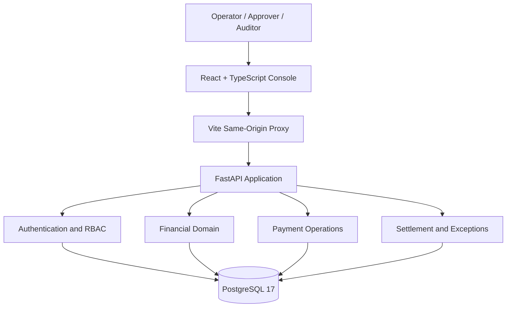
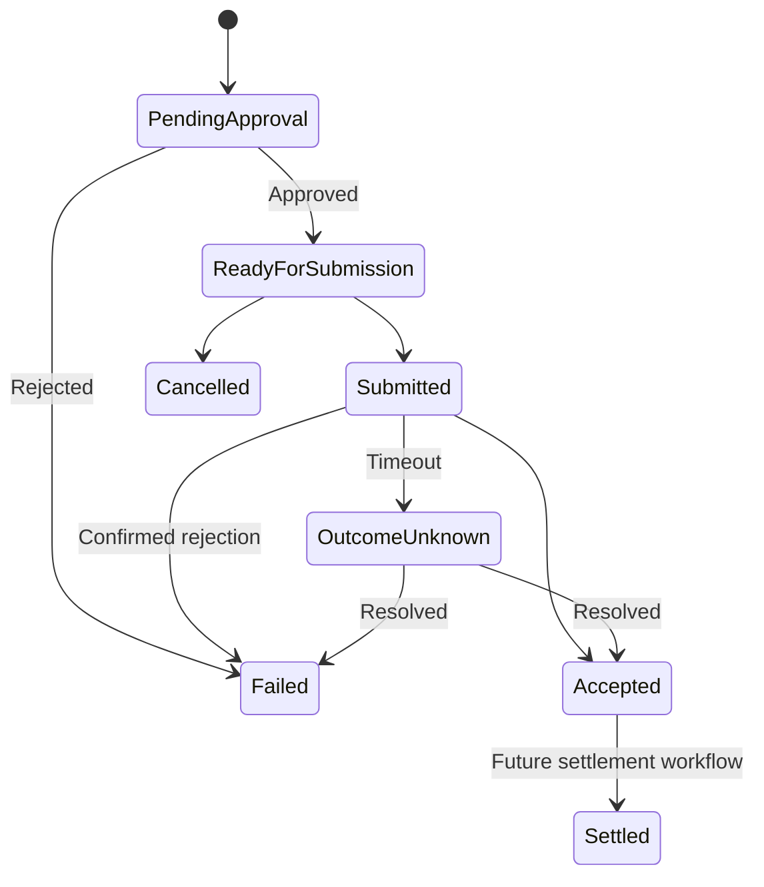

# LedgerOps
### Institutional Banking & Financial Operations Platform

LedgerOps is a cloud-native-oriented banking and financial operations platform built to demonstrate financial integrity, payment orchestration, operational controls and reliable backend engineering.

It combines a double-entry financial ledger, internal transfers, account reservations, maker-checker approvals, simulated payment rails, settlement processing and reconciliation within a modular monolith architecture.

The platform is designed around one core principle:

**Every financial operation must be traceable, authorized, atomic and auditable.**

> **Project status:** Core financial and banking operations are implemented through settlement and reconciliation. The final Exceptions & Investigations milestone (PR 7e) is currently in development.

---

## 1. Overview

Traditional financial dashboards often focus on displaying balances and transaction histories. LedgerOps goes further by implementing the backend controls and operational workflows that make financial operations reliable.

The platform demonstrates:

- Customer and account ownership.
- Double-entry bookkeeping.
- Immutable financial journals.
- Transactional account balance projections.
- Concurrency-safe internal transfers.
- Persistent idempotency.
- Account holds and available-balance enforcement.
- Maker-checker approval workflows.
- Simulated external payment instructions.
- Settlement batches and reconciliation.
- Operational exception management.

LedgerOps uses simulated financial infrastructure. It does not connect to real banks, process actual payments or claim regulatory certification.

## 2. Key capabilities

### Customer and account management

- Multi-customer membership model.
- Multiple users per customer.
- Customer-scoped account access.
- Customer-facing deposit accounts.
- Separate ledger accounts.
- Account status and currency management.
- Authorized account provisioning.

### Financial integrity and ledger

- Double-entry journal accounting.
- Balanced debit and credit postings.
- Immutable posted journals.
- PostgreSQL-enforced financial constraints.
- Atomic ledger posting.
- Transactional balance projections.
- Ledger and available-balance separation.
- INR monetary processing using decimal precision.

### Internal transfers

- Account-to-account internal transfers.
- Persistent idempotency keys.
- Request fingerprint validation.
- PostgreSQL row-level locking.
- Concurrent overdraft prevention.
- Transactional journal posting and audit records.
- Safe retry of ambiguous requests.

### Account holds

- Funds reservation.
- Available-balance enforcement.
- Partial and full release.
- Hold expiration.
- Hold capture through financial posting.
- Concurrency-safe reservation handling.
- Transactional lifecycle history.

### Maker-checker approvals

- Versioned approval policies.
- Approval request lifecycle.
- Independent reviewer decisions.
- Self-approval prevention.
- Separation of duties.
- Hold-backed pending transfers.
- Atomic final approval and posting.
- Rejection and expiry handling.

### Payment orchestration

- External payment instructions.
- Simulated payment rail adapter.
- Payment lifecycle tracking.
- Approval integration.
- Persistent idempotency.
- Retry handling.
- Ambiguous outcome protection.
- Reservation retention until settlement.

Supported simulated outcomes include:

- Accepted.
- Confirmed rejection.
- Temporary unavailability.
- Ambiguous timeout.
- Cancellation where permitted.

Accepted payments are not represented as settled payments.

### Settlement and reconciliation

- Platform-wide INR nostro account.
- Settlement batches.
- Individual settlement item tracking.
- Atomic outbound settlement posting.
- Shared nostro liquidity protection.
- CSV statement import.
- Duplicate statement detection.
- Reconciliation runs.
- Exact matching and discrepancy classification.
- Auditable settlement history.

### Exceptions and investigations

*Implementation in progress.*

The planned operational workspace includes:

- Payment and settlement exceptions.
- Reconciliation discrepancies.
- Expired approval and stale-hold exceptions.
- Customer-scoped investigation queues.
- Assignment and reassignment.
- Investigation notes.
- Resolution and closure.
- Append-only operational event history.

## 3. Technology stack

| Layer | Technology |
|---|---|
| Frontend | React, TypeScript |
| Development server | Vite |
| Backend | Python, FastAPI |
| ORM | SQLAlchemy 2.x |
| Database | PostgreSQL 17 |
| Migrations | Alembic |
| Data validation | Pydantic |
| Authentication | Cookie-based sessions |
| Password security | Argon2id |
| Authorization | Role-based access control |
| Financial precision | Python Decimal, PostgreSQL NUMERIC |
| Testing | Pytest, Vitest |
| Static analysis | Ruff, mypy, import-linter |
| Containerization | Docker, Docker Compose |
| CI/CD | GitHub Actions |

## 4. Architecture

LedgerOps follows a modular monolith architecture.

The frontend communicates with the FastAPI backend through a same-origin Vite reverse proxy. PostgreSQL remains the authoritative source of financial data.



### Backend module boundaries

The backend separates major business responsibilities:

- Authentication and authorization.
- Customer and account management.
- Financial ledger and posting.
- Internal transfers.
- Account holds.
- Approval workflows.
- Payment instructions.
- Settlement and reconciliation.
- Operational exceptions.

Business logic belongs in domain services rather than directly inside API routers.

### Architectural principles

1. PostgreSQL is the financial source of truth.
2. Financial operations execute within explicit database transactions.
3. Posted journals cannot be modified or deleted through normal application operations.
4. All monetary calculations use Decimal rather than floating-point arithmetic.
5. Concurrency-sensitive operations use PostgreSQL row-level locking.
6. Idempotency is stored persistently in PostgreSQL.
7. Audit records are written within the associated business transaction.
8. Platform permissions and customer membership are both enforced.
9. External payment processing is explicitly simulated.

## 5. Financial accounting model

### Double-entry accounting

Every posted financial journal must balance:

\[
\text{Total Debits} = \text{Total Credits}
\]

A customer deposit is represented as a liability of the platform.

For an internal transfer of INR 1,000:

| Posting | Debit | Credit |
|---|---:|---:|
| Source customer deposit liability | ₹1,000 | — |
| Destination customer deposit liability | — | ₹1,000 |
| **Total** | **₹1,000** | **₹1,000** |

### Account balances

The platform distinguishes:

- Ledger balance: the posted financial balance.
- Held amount: funds reserved for pending operations.
- Available balance: funds available for new operations.

The initial balance rule is:

\[
\text{Available Balance} =
\text{Ledger Balance} - \text{Active Holds}
\]

### Platform-wide nostro

LedgerOps uses a dedicated platform-owned INR nostro ledger account for simulated external payment settlement.

Outbound settlement follows:

| Posting | Debit | Credit |
|---|---:|---:|
| Customer deposit liability | ₹1,000 | — |
| Platform INR nostro asset | — | ₹1,000 |

The nostro is not a customer-owned account and is not exposed through ordinary customer account APIs.

### Money representation

Financial values use:

- Python `Decimal` in backend calculations.
- PostgreSQL `NUMERIC(18,2)` for INR amounts.
- Decimal strings in API requests and responses.
- Explicit currency fields.

JavaScript floating-point arithmetic is not used for financial calculations.

Initial processing supports INR only. Cross-currency FX execution is not implemented.

## 6. Payment lifecycle

Payment instructions are distinct from internal transfers.

The simulated payment lifecycle distinguishes payment acceptance from settlement.



Important financial behavior:

- Payment creation reserves funds.
- Approval is required when an applicable policy matches.
- Accepted payments retain their holds.
- Ambiguous timeouts retain their holds.
- Confirmed terminal failures release their holds.
- Settlement is responsible for the final financial posting.

A simulated rail acceptance is not proof of real-world settlement.

## 7. Security and access control

LedgerOps implements:

- Argon2id password hashing.
- Opaque cookie-based sessions.
- Hashed session-token storage.
- CSRF protection.
- Same-origin frontend/backend communication.
- Explicit permission-based authorization.
- Customer membership enforcement.
- Append-only audit records.
- Account-level ownership checks.

### Platform roles

The platform uses explicit roles:

| Role | Intended responsibility |
|---|---|
| Admin | Authorized platform administration |
| Operator | Financial operations and authorized transfers |
| Approver | Independent approval decisions |
| Auditor | Read-only operational and audit access |
| Viewer | Restricted read-only access |

A platform role does not automatically grant unrestricted customer access. Customer membership and resource-level authorization remain mandatory.

### Auditability

Important financial and operational actions are recorded with identifiable actors and timestamps.

Audit records provide an operational history but should not be described as absolutely immutable against privileged database administrators.

## 8. Getting started

### Prerequisites

- Git.
- Docker Desktop.
- Docker Compose.
- Windows PowerShell or a compatible terminal.

Docker Compose manages the development services.

### Clone the repository

```powershell
git clone https://github.com/darshsoam07/Expense-Tracker-with-Insights.git

cd Expense-Tracker-with-Insights
```

### Configure the environment

Review the repository's environment template, backend configuration and `docker-compose.yml`.

Provide the required local configuration without committing secrets or `.env` files.

### Start the application

```powershell
docker compose config --quiet

docker compose up --build -d --wait --wait-timeout 180

docker compose ps
```

The application uses the frontend reverse proxy for API requests.

### Access LedgerOps

| Service | Address |
|---|---|
| Web application | http://localhost:5173 |
| Backend health | http://localhost:8000/health/live |
| Backend readiness | http://localhost:8000/health/ready |
| Proxied readiness | http://localhost:5173/health/ready |

The frontend uses relative `/api/v1/...` requests. Browser clients should not need a separate backend origin.

### Stop the application

```powershell
docker compose down
```

This stops and removes containers without deleting named database volumes.

**Warning:** Avoid `docker compose down -v` unless you explicitly intend to delete the database and other named volume data.

## 9. Synthetic workspace provisioning

LedgerOps provides an explicit synthetic workspace provisioning workflow.

Provisioning creates a synthetic organization, customer accounts and opening funding using the supported financial posting services.

The operation uses the migration identity and is explicitly invoked; application startup does not automatically create financial customers or fund accounts.

Start the stack:

```powershell
docker compose up --build -d --wait
```

Use an existing authorized local administrator or operator UUID:

```powershell
docker compose run --rm --no-deps migrate python -m app.modules.finance.provision --user-id <existing-user-uuid>
```

The provisioning command is idempotent for the same user.

The synthetic opening funding is recorded against the platform-wide INR nostro through a balanced journal and is attributed to the `system:synthetic-provision` principal.

Use synthetic data only for local development and testing.

## 10. API overview

LedgerOps exposes versioned FastAPI endpoints under `/api/v1`.

Core API areas include:

| Domain | Endpoint examples |
|---|---|
| Authentication | `/api/v1/auth/login`, `/api/v1/auth/logout`, `/api/v1/me` |
| Accounts | `/api/v1/accounts` |
| Account ledger | `/api/v1/accounts/{account_id}/ledger` |
| Internal transfers | `/api/v1/transfers` |
| Approvals | `/api/v1/approvals` |
| Payments | `/api/v1/payments` |
| Settlement | `/api/v1/settlements/batches` |
| Statement import | `/api/v1/settlements/statements/import` |
| Reconciliation | `/api/v1/settlements/reconciliation-runs` |
| Exceptions | `/api/v1/exceptions` |

State-changing operations require the appropriate authenticated session, permissions and CSRF protection.

The actual API request and response schemas are maintained in the backend implementation.

## 11. Development and testing

### Backend

From the backend directory, activate the repository's configured Python virtual environment and run:

```powershell
ruff check .
ruff format --check .
mypy
lint-imports
pytest
```

PostgreSQL integration tests require the configured test and migration database URLs.

Use PostgreSQL 17 for tests involving:
- Row-level locking.
- Financial posting constraints.
- Database triggers.
- Migrations.
- Concurrency.
- Transaction rollback.
- Idempotency.

SQLite is not a replacement for these financial integrity tests.

### Frontend

From the frontend directory:

```powershell
npm ci

npm run typecheck

npm test

npm run build
```

### Infrastructure verification

From the repository root:

```powershell
docker compose config --quiet

docker compose up --build -d --wait --wait-timeout 180

docker compose ps
```

Verify both health endpoints and inspect service logs for startup failures and accidental secret exposure.

### Continuous integration

The GitHub Actions pipeline includes:
- Backend lint and type validation.
- Backend architecture checks.
- PostgreSQL 17 integration testing.
- Frontend typecheck.
- Frontend unit tests.
- Production build.
- Windows compatibility checks.

A local test result does not automatically imply that the corresponding hosted GitHub Actions job has passed.

## 12. Repository structure

The main application areas are organized as follows:

```text
.
├── backend/
│   ├── app/
│   │   ├── api/
│   │   ├── core/
│   │   ├── db/
│   │   └── modules/
│   │       ├── auth/
│   │       └── finance/
│   ├── migrations/
│   └── tests/
│       ├── api/
│       ├── integration/
│       └── unit/
│
├── frontend/
│   └── src/
│       ├── components/
│       ├── context/
│       ├── pages/
│       └── api.ts
│
├── docs/
│   ├── architecture/
│   │   └── adr/
│   └── product/
│
├── legacy/
│   └── expense-tracker/
│
├── scripts/
├── docker-compose.yml
├── .github/
│   └── workflows/
├── AGENTS.md
└── README.md
```

The legacy Expense Tracker is preserved separately and is not the financial source of truth for LedgerOps.

## 13. Design system

LedgerOps uses an Institutional Luxury interface direction.

The visual system emphasizes:

- Warm stone and ivory surfaces.
- Obsidian forest navigation.
- Restrained emerald primary accents.
- Champagne secondary accents.
- Manrope interface typography.
- IBM Plex Mono for identifiers and financial metadata.
- Clear information hierarchy.
- Responsive operational tables and workflows.
- Accessible keyboard and focus behavior.

The console prioritizes financial information, operational state and traceability over decorative dashboards or fabricated metrics.

## 14. Roadmap and project status

The initial implementation roadmap:

| Milestone | Capability | Status |
|---|---|---|
| PR 3 | PostgreSQL foundation | Completed |
| PR 3H | Database foundation follow-up | Completed |
| PR 5 | Institutional Luxury UI shell | Completed |
| PR 4a | Identity, RBAC, sessions and audit | Completed |
| PR 4b | Frontend authentication integration | Completed |
| PR 6a | Financial integrity and double-entry ledger | Completed |
| PR 7a | Account holds and available-balance enforcement | Completed |
| PR 7b | Maker-checker approvals | Completed |
| PR 7c | Simulated payment rails | Completed |
| PR 7d | Settlement and reconciliation | Completed |
| PR 7e | Exceptions and investigations | In progress |

PR numbers describe the project roadmap and are not necessarily the corresponding GitHub pull request numbers.

The initial application is intended to provide a coherent financial operations experience. Additional cloud deployment and operational engineering work can be undertaken separately.

## 15. Current limitations

LedgerOps is a simulated financial operations platform.

The following capabilities are intentionally not implemented:

- Real bank connectivity.
- Licensed banking services.
- Actual external payment execution.
- FX and cross-currency settlement.
- Production-grade AML/KYC certification.
- Automated fraud decisions.
- Full treasury and liquidity automation.
- Production deployment guarantees.

Payment rail responses and external settlement behavior are simulated.

Accepted payments are distinct from settled payments.

The initial settlement accounting supports INR only.

Operational exception management is being completed separately from the financial ledger.

## 16. Project goals

LedgerOps is designed to demonstrate engineering capabilities across:

- Financial systems and accounting integrity.
- Transaction-safe backend development.
- Database schema design and migrations.
- Concurrency and idempotency.
- Authentication and authorization.
- API design.
- Operational workflow engineering.
- Frontend integration.
- Automated testing and CI.
- Dockerized application development.

The emphasis is not simply on displaying financial data, but on ensuring that financial operations remain consistent, traceable and correctly authorized.

---

**LedgerOps — Financial operations built around integrity, control and observability.**
