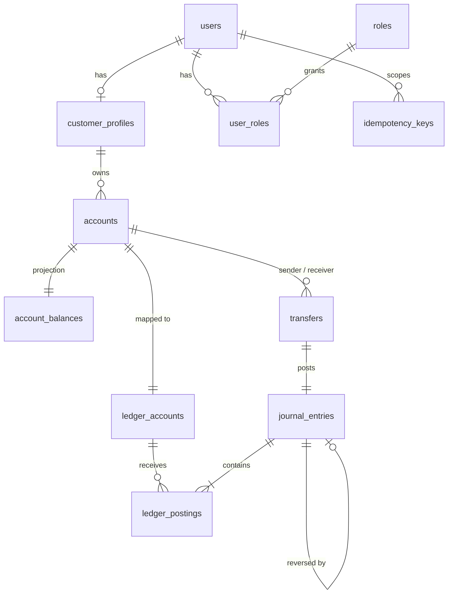

# LedgerOps Phase 1: Implementation Plan

**Status: approved by the project owner on 15 November 2026, with clarifications A to D (incorporated below).**
Baseline: `main` at `e1b3984` (tag `legacy-v1`). Phase 1 is **PR 1 to PR 5**. Only PR 1 is authorised so far; each later PR needs separate approval.

Everything in this document that is not marked as done is a **target, not a result**. Nothing in the new stack exists yet.

## 0. Approved decisions

- **D1** Minimal GitHub Actions CI (lint and tests) in PR 2. **D2** React frontend shell in PR 5. **D3** Redis deferred to Phase 3. **D4** Synchronous SQLAlchemy 2.x with `psycopg` 3.
- Cookie sessions with CSRF; PostgreSQL-backed sessions; double-entry ledger as source of truth with a transactionally maintained balance projection; row locking in ascending account-ID order; system settlement accounts; `NUMERIC(18,2)` / `Decimal` / string money; INR only in v1.
- One `amount` plus `direction` (debit or credit) per posting. The database must enforce balanced journal entries and immutability; reversals are new entries.
- The legacy app is used locally only and is not publicly deployed. The new application must contain no debug-mode production configuration and no insecure default secrets.
- Product name **LedgerOps**. The GitHub repository is not renamed without presenting the change first.
- No AWS resources, Terraform, public deployment or cloud spend without separate explicit approval.

## 1. Repository structure

**After PR 1** (this PR; no new application code):

```
LedgerOps/
├── legacy/expense-tracker/     # 13 original files, byte-identical to tag legacy-v1
├── docs/
│   ├── architecture/
│   │   ├── phase0-audit.md
│   │   ├── phase1-plan.md
│   │   └── adr/0001 ... 0006
│   └── legacy-migration.md
├── scripts/
│   ├── verify_relocation.py
│   └── verify_legacy.py
├── README.md   .gitignore   .gitattributes
```

**After Phase 1** (PR 5), additions only:

```
├── backend/
│   ├── app/
│   │   ├── main.py             # app factory, middleware, router wiring
│   │   ├── core/               # config, logging, db session, security, errors, request_id
│   │   ├── modules/{auth,customers,audit}/   # router.py service.py models.py schemas.py
│   │   └── cli.py              # create-user / seed commands (never an HTTP route)
│   ├── migrations/             # Alembic
│   ├── tests/{unit,integration,api}/
│   ├── pyproject.toml   Dockerfile
├── frontend/
│   ├── src/{app,components,pages,features,lib}/
│   ├── package.json  vite.config.ts  Dockerfile  nginx.conf
├── deployment/docker-compose.yml
├── .github/workflows/ci.yml    # lint and tests only (D1)
├── .env.example
```

`worker/`, `infrastructure/` and `observability/` are **not created** until their phases.

**Module rules**, enforced by an automated test: routers never touch database models directly (they call the module's `service.py`); modules call each other only through services; only the future `ledger` module may write postings or balances. `import-linter` contracts are added in PR 2.

## 2. PR 1: file-by-file

PR 1 has **two commits**, kept separate on purpose:

1. **Rename only, zero content edits.** All 13 files `git mv`-ed into `legacy/expense-tracker/`.
2. **Additions only:**

| File | Content |
|---|---|
| `README.md` | Product summary, honest status, scope disclaimer, how to run legacy (PowerShell and Git Bash) |
| `.gitignore` | Clean rules (Python, Node, env files, local DBs, Terraform state, editors). The corrupted legacy `.gitignore` is left untouched inside `legacy/` |
| `.gitattributes` | `* text=auto`; `*.sh` forced to LF |
| `docs/architecture/phase0-audit.md`, `phase1-plan.md`, `adr/0001-0006-*.md` | This record |
| `docs/legacy-migration.md` | Preflight, verification, Docker-on-Windows steps, rollback |
| `scripts/verify_relocation.py`, `scripts/verify_legacy.py` | Cross-platform Python verification (replaces the Bash script proposed earlier, for Windows compatibility) |

Not touched: the content of any legacy file, the repository name or remote settings. Merge PR 1 with a **merge commit** (not squash) so the rename-only commit stays distinct.

## 3. Legacy relocation and migration safety (clarification D)

Preflight, relocation, tag and verification steps, with expected output, are in [`docs/legacy-migration.md`](../legacy-migration.md). In summary: verify a clean tree, branch `main`, baseline `e1b3984`, local equals origin, no existing `legacy/` path and no existing tag; create the annotated tag and verify it points at the baseline; relocate with rename-only commit; verify 100% renames, identical blob hashes, preserved `--follow` history; smoke-test the relocated app. No force-push and no history rewrite at any point.

## 4. Architecture decision records

| ADR | Decision |
|---|---|
| [0001](adr/0001-cookie-sessions-with-csrf.md) | Cookie sessions with CSRF, including the CSRF bootstrap before login (clarification B) |
| [0002](adr/0002-ledger-source-of-truth-and-balance-projection.md) | Ledger as source of truth; balance projection; lock ordering; DB-enforced invariants |
| [0003](adr/0003-system-settlement-accounts.md) | Settlement accounts and debit/credit conventions |
| [0004](adr/0004-money-representation.md) | `NUMERIC(18,2)`, `Decimal`, string JSON, INR only |
| [0005](adr/0005-sessions-in-postgresql.md) | Sessions stored in PostgreSQL |
| [0006](adr/0006-strangler-migration.md) | Strangler migration, legacy preserved |

## 5. Backend and frontend foundation

**Backend.** Python 3.12, FastAPI, SQLAlchemy 2.x (sync), `psycopg` 3, Alembic, `pydantic-settings`, `argon2-cffi`, `structlog`, `pytest`, `ruff`, `mypy`. Exact versions will be checked and pinned in a lock file at implementation time; none are pinned yet.

- App factory (`create_app(settings)`) so tests can build isolated apps.
- Pipeline: request-ID middleware, security headers, session loader, CSRF and Origin check (state-changing methods), router.
- Error shape for every failure: `{"error": {"code": "...", "message": "...", "request_id": "...", "details": []}}`. Unhandled exceptions return a generic 500 with the request ID, never a traceback.
- Logs: JSON to stdout with `request_id`, `level`, `event`; fields named `password`, `token`, `cookie`, `authorization` are dropped. Audit events go to a database table, never to logs.
- Roles `customer`, `admin`, `operations`. Registration creates `customer` only. Privileged users are created by a CLI command, never through HTTP.

### API routes and reverse proxy (clarification A)

**All application endpoints live under `/api/v1/`**, including authentication, profiles, operations, and the OpenAPI documents (`/api/v1/docs`, `/api/v1/openapi.json`; FastAPI's defaults are overridden because its default `/docs` would sit outside the prefix). **Only** `/health/live` and `/health/ready` sit outside the version prefix.

| Method and path | Purpose |
|---|---|
| `GET /api/v1/auth/csrf` | Anonymous CSRF token (ADR-0001) |
| `POST /api/v1/auth/register` | Create customer and session |
| `POST /api/v1/auth/login` | Create session |
| `POST /api/v1/auth/logout` | Revoke session |
| `GET /api/v1/me` | Current user, roles, session CSRF token |
| `GET /api/v1/customers/me` | Own customer profile |
| `GET /api/v1/ops/ping` | Role-gate probe: static OK, operations/admin only. Not a health or metrics indicator |
| `GET /health/live`, `GET /health/ready` | Liveness (process up); readiness (database reachable and schema at Alembic head) |

Design sketch for the frontend container's NGINX (**not yet written or tested**):

```nginx
server {
  listen 8080;
  root /usr/share/nginx/html;
  client_max_body_size 1m;

  location /api/    { proxy_pass http://backend:8000;   # no trailing slash: path is preserved
                      proxy_set_header Host $host;
                      proxy_set_header X-Forwarded-For $proxy_add_x_forwarded_for;
                      proxy_set_header X-Forwarded-Proto $scheme; }
  location /health/ { proxy_pass http://backend:8000; } # local convenience only
  location /        { try_files $uri /index.html; }     # single-page-app fallback
}
```

PR 5 acceptance tests for this: `GET /api/v1/auth/csrf` through NGINX returns JSON; an unknown `/api/...` path returns a JSON 404 and **not** `index.html`; deep links such as `/login` return the app. In AWS (Phase 5) the load balancer routes `/api/*` to the backend and the backend's `/health/ready` is used for target health checks.

**Frontend.** Vite, React, TypeScript, Tailwind built at compile time (the legacy CDN script is dropped), React Router, TanStack Query, Vitest and Testing Library. The Phase 1 UI is small: register, login, logout, a protected "me" page, role-aware navigation. It reuses the legacy navy/teal visual language, not its code. The CSRF token lives in memory only.

## 6. Database entities and initial schema

IDs exposed to clients are UUIDs; audit rows use a bigserial. Timestamps are `timestamptz` in UTC.

**Migrated in Phase 1 (PR 3 and PR 4):**

| Table | Key columns and constraints |
|---|---|
| `users` | `id` UUID PK; `email_normalized` UNIQUE; `name`; `password_hash`; `status` (`active`/`locked`/`disabled`); `failed_login_count`; `locked_until`; `created_at` |
| `roles` | `id` smallint PK; `name` UNIQUE, seeded with the three roles |
| `user_roles` | PK (`user_id`, `role_id`); FKs `ON DELETE RESTRICT` |
| `customer_profiles` | `id` UUID PK; `user_id` UNIQUE FK; `customer_ref` UNIQUE; `status`. Minimal personal data |
| `sessions` | `id` UUID PK; `token_hash` UNIQUE; `user_id` FK; `csrf_token`; `created_at`; `last_seen_at`; `expires_at`; `revoked_at`. Index on `user_id` |
| `audit_events` | `id` bigserial PK; `occurred_at`; `actor_user_id` nullable FK; `action`; `target_type`; `target_id`; `request_id`; `metadata` jsonb (safe fields only). **A trigger rejects `UPDATE` and `DELETE`** |

**Designed now, migrated in Phase 2:**



Key Phase 2 constraints (see ADR-0002): `ledger_postings` has `amount NUMERIC(18,2) CHECK (amount > 0)` plus `direction`; a deferred constraint trigger enforces balanced journal entries at commit; triggers reject `UPDATE`/`DELETE` on postings and journal entries; reversals are new entries with a unique `reverses_entry_id`; `account_balances.ledger_balance >= 0` for customer accounts; `idempotency_keys` unique per (`user_id`, `key`) with a hash of the request body, so reusing a key with a different body is rejected.

**Migration discipline:** one Alembic revision per PR; CI runs `upgrade head`, `downgrade base`, `upgrade head` on a clean PostgreSQL. No manual schema edits.

## 7. Security requirements and configuration

All settings come from environment variables through `pydantic-settings`. `.env.example` lists every variable with a placeholder; `.env` is git-ignored. The app **refuses to start** when `SECRET_KEY` is missing, under 32 characters, or contains a known placeholder (outside `APP_ENV=local|test`), or when `APP_ENV` is `staging`/`production` with `COOKIE_SECURE` false or debug enabled. There is no debug-server code path in the new backend; auto-reload is a flag on the local dev command only.

| Control | Phase 1 requirement |
|---|---|
| Passwords | Argon2id; length 12 to 128 |
| Login errors | Same message and similar timing for unknown email and wrong password |
| Brute force | Per-account failure counter with temporary lock in PostgreSQL; per-IP limiting deferred to the load balancer/WAF |
| Cookies | `HttpOnly`, `Secure`, `SameSite=Lax`; `Secure` may be off only when `APP_ENV=local` |
| CSRF | ADR-0001 (anonymous token via `/api/v1/auth/csrf`, per-session token, rotation on auth changes) |
| Headers | CSP, `X-Content-Type-Options`, frame protection, `Referrer-Policy`, HSTS outside local |
| CORS | None; same-origin only |
| Input | Pydantic schemas on every route; request-size limit; money rules from ADR-0004 |
| Containers | Non-root, pinned base image tag, `HEALTHCHECK` |
| Secrets | Never in Git; CI uses repository secrets; AWS Secrets Manager only after separate approval |

Known limitation, documented rather than hidden: registration reveals whether an email exists, because there is no email-verification flow in a simulated system.

## 8. Windows development (clarification C)

Primary development environment: **Windows**. Both **PowerShell** and **Git Bash** are supported.

- **No Bash-only scripts** exist in PR 1. The verification scripts are Python and run identically in both shells (`py` on Windows).
- `make` is not installed on Windows by default. **No step will require it.** If a `Makefile` is added, every target will have its raw command documented, and PowerShell and Git Bash variants where they differ.
- Any future `.sh` file will be labelled Bash-only in the docs, forced to LF line endings by `.gitattributes`, and used only inside containers or CI, or given a Python equivalent.

| Task | PowerShell | Git Bash |
|---|---|---|
| Activate venv | `.\.venv\Scripts\Activate.ps1` | `source .venv/Scripts/activate` |
| Set a variable for this session | `$env:NAME = "value"` | `export NAME=value` |
| Copy `.env.example` | `Copy-Item .env.example .env` | `cp .env.example .env` |
| curl | `curl.exe ...` (plain `curl` is an alias) | `curl ...` |
| Docker Compose | identical in both | identical in both |

Other Windows rules: use Docker Desktop (WSL2 backend recommended); PostgreSQL data uses a **named volume**, not a bind mount, to avoid Windows permission problems; Dockerfiles and entrypoint scripts must be LF (CRLF breaks `#!` lines in Linux containers). CI runs on Linux, so Windows-specific problems will not be caught automatically: I cannot run Windows here, so I will ask you to confirm Windows-sensitive steps.

## 9. Testing strategy and acceptance criteria

Integration tests run against a **real PostgreSQL** (compose locally, service container in CI), never SQLite.

**Phase 1 exit criteria** (each backed by an artifact):

1. From a clean clone, copying `.env.example` to `.env` and running the documented compose command starts API, web and database, and `/health/ready` returns 200.
2. The documented test command passes. Backend line coverage on `app/` is at least 85% (a target; the real figure will be reported).
3. `ruff check`, `ruff format --check`, `mypy`, `import-linter`, frontend `tsc` and `vitest` pass in CI.
4. Migration round trip (up, down, up) passes on an empty database.
5. The authorization matrix below is fully tested, with no untested cell.
6. Application start-up fails with a clear message for each bad-configuration case in section 7 (one test each).
7. No secret values in the repository (manual `git grep` check recorded in the PR until secret scanning lands).

**Authorization matrix (Phase 1):**

| Endpoint | Anonymous | Customer | Operations | Admin |
|---|---|---|---|---|
| `GET /api/v1/auth/csrf`, `POST .../auth/register`, `POST .../auth/login` | allow | allow | allow | allow |
| `GET /api/v1/me`, `GET /api/v1/customers/me`, `POST /api/v1/auth/logout` | 401 | allow | allow | allow |
| `GET /api/v1/ops/ping` | 401 | **403** | allow | allow |
| Any `POST`/`PUT`/`PATCH`/`DELETE` without a valid CSRF token | 403 | 403 | 403 | 403 |

**CSRF tests (ADR-0001):** anonymous token required for login and register; token from another session rejected; expired anonymous token rejected; header/cookie mismatch rejected; new token after login; token invalid after logout; `GET` never changes state.

Layers: unit (password rules, money parsing, session expiry, config validation, CSRF HMAC); integration (migrations, session lifecycle, audit-table append-only trigger, account lockout); API (every matrix cell, error shape, request ID on every response); frontend (form validation, login failure state, role-dependent navigation). Browser end-to-end starts in Phase 2.

## 10. Git branching and pull request strategy

- `main` is protected: pull request required, CI green required, no force-push.
- Short-lived branches with prefixes `chore/`, `feat/`, `fix/`, `docs/`. One concern per PR.
- Conventional Commit messages. **Squash-merge** by default; **merge commit for PR 1 only**.
- Every PR description states scope, files changed, design choices, test plan, exact commands run with their real output, an acceptance checklist, and a rollback note.

| PR | Scope | Key acceptance criteria |
|---|---|---|
| 1 | Relocation, docs, ADRs, verification scripts | Preflight passes; 13 files are R100; blob hashes identical; legacy smoke test passes |
| 2 | Backend skeleton and minimal CI (D1) | Config validation tests; `/health/live` and `/health/ready` tested; JSON logs carry request IDs; import-linter in CI |
| 3 | PostgreSQL, SQLAlchemy, Alembic, Compose | Baseline migration round trip; readiness fails when the database is down (tested); non-root image |
| 4 | Auth, sessions, CSRF, roles, profile, audit | Full authorization and CSRF test matrix; Argon2id; lockout; append-only audit table |
| 5 | Frontend shell and NGINX (D2) | Register, login, logout, `me` work in a browser through NGINX same-origin; `/api/` proxy tests; frontend tests pass |

**Who runs what:** the sandbox used to prepare PRs can read the public repository but cannot push to GitHub. Each PR is delivered as a Git bundle or patch plus commands; the owner pushes and merges unless write access is granted.

## 11. Risks, dependencies, rollback

| Risk | Mitigation |
|---|---|
| History lost or muddied by the move | Rename-only commit, R100 check, blob-hash comparison, merge commit for PR 1 |
| Windows line endings change file hashes | `.gitattributes` `text=auto`; hashes are compared as Git objects, which are LF-normalised |
| Docker behaviour unverified | Owner runs the compose steps and reports results; no Docker success is claimed until then |
| Compose project/volume name changes after the move | Documented in `docs/legacy-migration.md` |
| Dependency version drift | Verify versions at implementation time; commit lockfiles |
| Scope creep into banking features | PR 5 ends Phase 1; ledger work waits for Phase 2 approval |
| Concurrency bugs (Phase 2) | Designed now (ADR-0002) so the Phase 1 schema does not block it |
| Single reviewer | CI gates, PR checklists, ADRs as written reasoning |
| CSRF/session design flaws | Design written first (ADR-0001), tested in PR 4, explicit negative tests |

**Dependencies:** a Windows machine with Docker Desktop, Python 3.10+ (`py`), Node, and Git; a GitHub repository with Actions enabled. No AWS account is needed in Phase 1.

**Rollback:** any PR via `git revert` (no external side effects in Phase 1); relocation via `git revert -m 1 <merge-commit>` or `git checkout legacy-v1`; database migrations through tested `downgrade`; local data reset with `docker compose down -v`; never force-push `main`; no cloud resources exist, so nothing to tear down.
